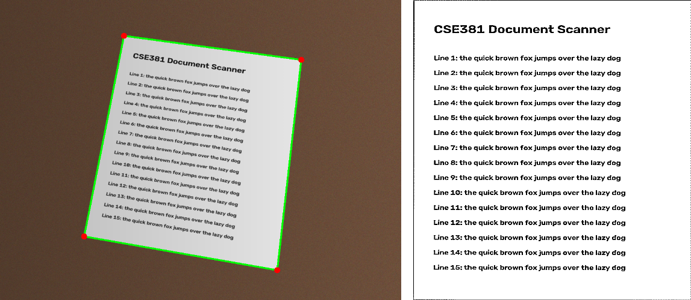

# Automatic Document Scanner

Turns a phone photo of a page or ID card taken at an angle into a flat, clean "scanned" image — the
CamScanner problem, solved with classical computer vision. It finds the page's four corners
automatically (no clicking), straightens the page with a homography, and applies adaptive thresholding
for a crisp black-and-white result. A whole folder of photos can be batch-scanned into one PDF.

Useful for students digitizing notes, and for digitizing Arabic textbook material in the department.


<!-- TODO: replace with a 20-second demo GIF of your own photos -> docs/demo.gif -->

## Pipeline

1. Resize to 800 px height (speed) → grayscale → Gaussian blur
2. Canny edge detection (auto thresholds from the median intensity) + dilation
3. Contours → `approxPolyDP` → largest convex 4-sided polygon = the page
   (fallback: minimum-area rectangle around the largest contour)
4. Order corners (TL, TR, BR, BL) → `getPerspectiveTransform` → `warpPerspective`
5. Adaptive Gaussian threshold → "scanned" look

## Result

<!-- TODO: fill in after testing on your own photos -->
Pages correctly detected and rectified: **XX / YY** photos (varied angles and lighting).

## How to run

```bash
git clone https://github.com/vanoxide/document-scanner
cd document-scanner
pip install -r requirements.txt
python scan.py --input samples/ --output output/ --pdf output/scans.pdf
```

Options: `--color` keeps color instead of black-and-white, `--debug` also saves each pipeline stage
(edges, detected outline, warped page). Run `python make_sample.py` to generate a synthetic test photo.

## Project structure

```
scan.py            command-line entry point (single image or whole folder, optional PDF)
scanner/utils.py   the pipeline: edges, corner detection, homography, threshold
make_sample.py     generates a synthetic angled-page photo for testing
samples/           example input photos
```

## What I learned

<!-- TODO: write two sentences in your own words -->

## Built with

Python · OpenCV · NumPy · Pillow — CSE381 Computer Vision, MSA University
